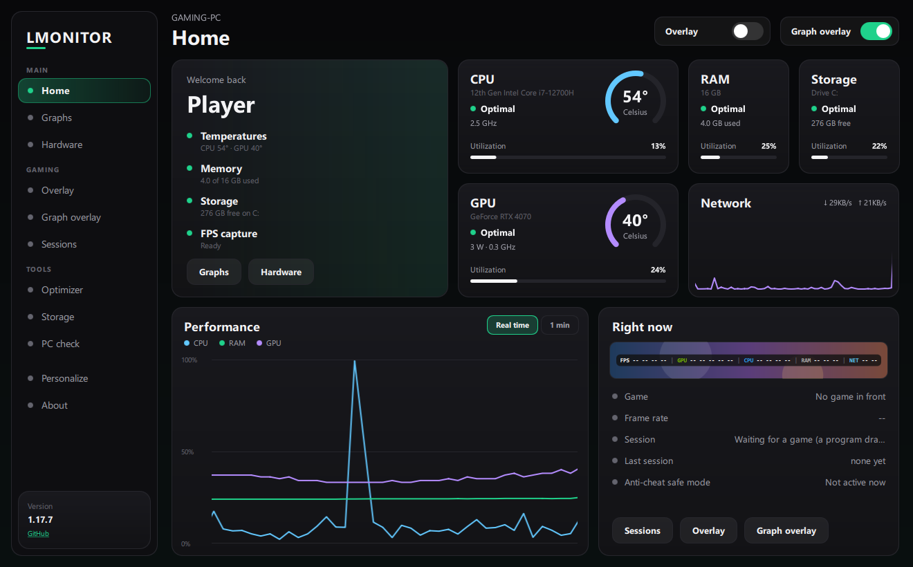
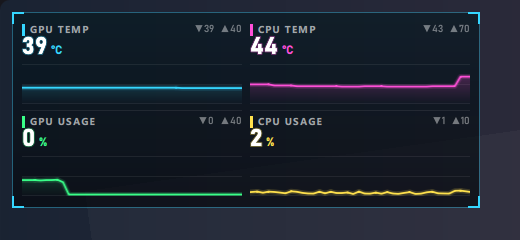
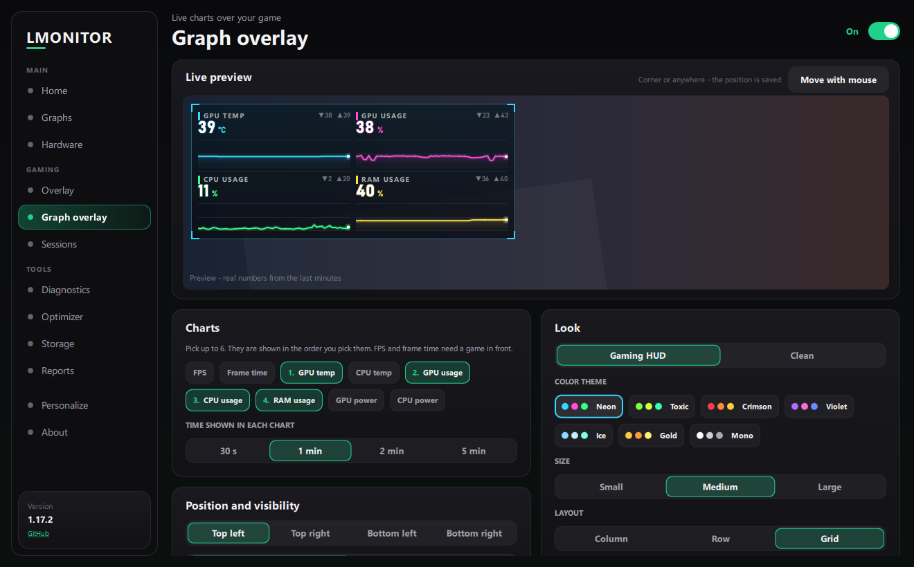
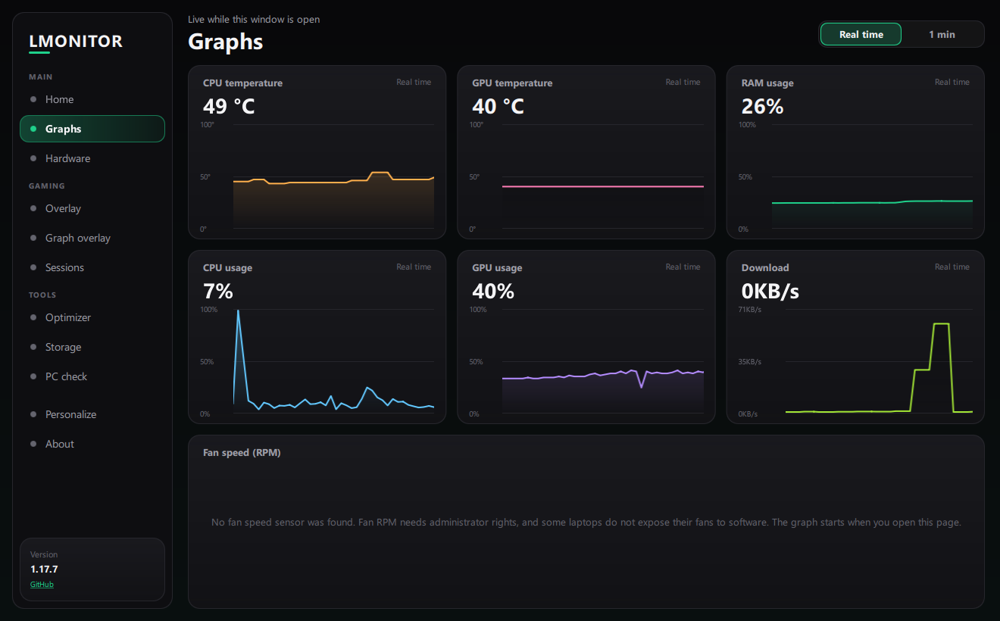
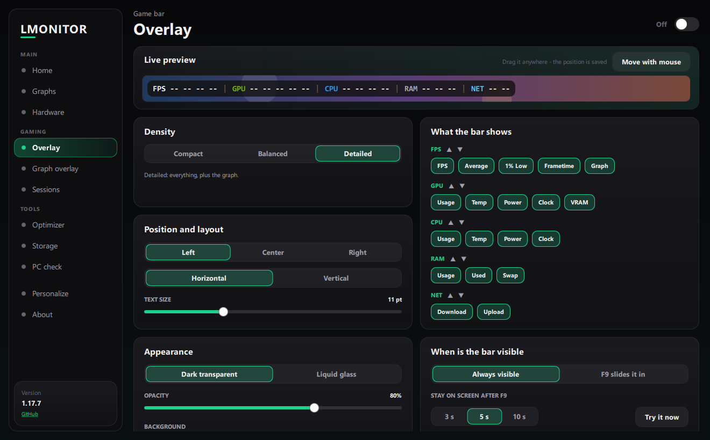
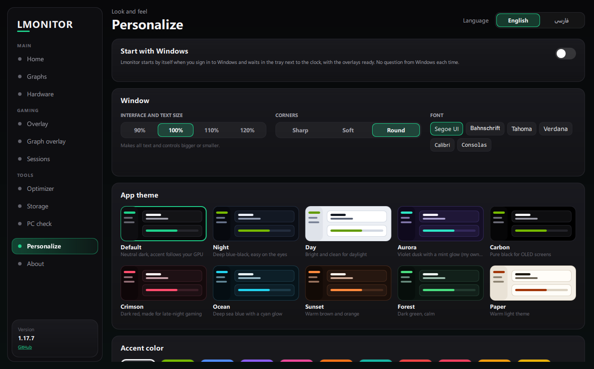

# Lmonitor

**اورلی گیمینگ و مانیتور سیستم برای ویندوز.**
یک نوار کوچک و بدون مزاحمت روی بازی شما قرار می‌دهد (FPS، ۱٪ Low، مصرف CPU / GPU / RAM، دما، توان، کلاک، سرعت اینترنت)، می‌تواند یک **اورلی نمودار** با نمودارهای زنده به سبک HUD گیمینگ اضافه کند، و یک داشبورد کامل در پنجره‌ی جداگانه دارد: نمودارها، ثبت سشن بازی، بررسی رایانه و ابزارهای پاک‌سازی امن. طوری ساخته شده که سربار کمی روی بازی داشته باشد (بخش *سبک روی بازی* را ببینید).

[English](README.md) · [دانلود](https://github.com/unrealhamed/Lmonitor/releases) · [گزارش باگ](https://github.com/unrealhamed/Lmonitor/issues/new?template=bug_report.md) · [پیشنهاد قابلیت](https://github.com/unrealhamed/Lmonitor/issues/new?template=feature_request.md)

> **وضعیت: نسخه‌ی اولیه (v1.18.0).** فقط توسط سازنده روی یک لپ‌تاپ ویندوز ۱۱ (RTX 4070 Laptop + Intel Core i7-12700H) آزمایش شده است. روی سخت‌افزارهای دیگر ممکن است بعضی سنسورها `n/a` نشان بدهند. گزارش باگ خوش‌آمد است.

## تصاویر



| اورلی نمودار (HUD گیمینگ) | تنظیمات اورلی نمودار |
|---|---|
|  |  |

| نمودارها (لحظه‌ای) | تنظیمات اورلی |
|---|---|
|  |  |



## دانلود و نصب

۱. به صفحه‌ی [**Releases**](https://github.com/unrealhamed/Lmonitor/releases) بروید و از جدیدترین نسخه فایل `Lmonitor_Setup_x.y.z.exe` را دانلود کنید.
۲. اجرا کنید و مراحل نصب را بروید. تیک **Install the PawnIO driver** را نگه دارید: درایور سنسوری را نصب می‌کند که دما و توان CPU روی بسیاری از پردازنده‌ها به آن نیاز دارد. میان‌بر دسکتاپ و Start Menu ساخته می‌شود.
۳. **Lmonitor** را باز کنید. ویندوز دسترسی ادمین می‌خواهد (برای خواندن سنسورها لازم است) - *Yes* را بزنید.
۴. حذف از *Settings > Apps*. هنگام حذف می‌پرسد تنظیمات هم پاک شود یا نه (پیش‌فرض: نگه داشتن).

> فایل نصبی امضای دیجیتال ندارد؛ پس ممکن است SmartScreen یا آنتی‌ویروس هشدار بدهد. فقط اگر به منبع دانلود (همین صفحه‌ی Releases) اعتماد دارید *More info > Run anyway* را بزنید.

## اورلی چه چیزهایی نشان می‌دهد

| گروه | موارد |
|---|---|
| **FPS** | FPS، میانگین، 1% Low، فریم‌تایم، نمودار زنده‌ی فریم‌تایم |
| **GPU** | مصرف، دما، توان، کلاک، VRAM |
| **CPU** | مصرف، دما، توان، کلاک |
| **RAM** | درصد مصرف، مقدار مصرفی/کل، Swap |
| **NET** | سرعت دانلود و آپلود (MB/s یا Mbps) |

هر مورد را می‌توان جداگانه روشن یا خاموش کرد. پیش‌تنظیم‌های *Density* (Compact / Balanced / Detailed) کل مجموعه را با یک کلیک عوض می‌کنند.

مقدارها با بار و دما از سفید به رنگ‌های هشدار تغییر می‌کنند (این آستانه‌ها انتخاب خود Lmonitor است، نه حد رسمی ویندوز یا سازنده‌ها):

| سطح | مصرف (CPU / GPU / RAM / VRAM) | دما |
|---|---|---|
| عادی | زیر ۳۰٪ - سفید | زیر ۴۰ درجه - سفید |
| گرم | ۳۰٪ به بالا - زرد | ۴۰ درجه به بالا - زرد |
| بالا | ۵۰٪ به بالا - قرمز | ۶۰ درجه به بالا - قرمز |
| بحرانی | ۷۰٪ به بالا - قرمز تیره | ۷۵ درجه به بالا - قرمز تیره |

### شخصی‌سازی اورلی
- **دو سبک:** *Dark Transparent* و *Liquid Glass* (محو‌کنندگی پشت پنجره‌ی ویندوز؛ به Windows 10 نسخه‌ی 1803 یا جدیدتر نیاز دارد، وگرنه نوار تیره‌ی نیمه‌شفاف استفاده می‌شود).
- **۱۰ پس‌زمینه**، ۶ رنگ برای مقدارها، **شفافیت**، **اندازه‌ی متن**، وزن Regular/Bold.
- **چیدمان:** افقی یا عمودی. **موقعیت:** چپ، وسط، راست یا دلخواه - نوار را با ماوس بکشید؛ موقعیت ذخیره می‌شود و همیشه داخل صفحه می‌ماند.
- **ترتیب:** جابه‌جایی بخش‌ها.
- **حالت F9:** به‌جای ماندن دائمی روی صفحه، نوار با زدن **F9** از لبه‌ی بالا پایین می‌آید (حتی وقتی بازی فوکوس دارد)، ۳ / ۵ / ۱۰ ثانیه می‌ماند و برمی‌گردد. کلید F9 مسدود نمی‌شود، پس بازی‌ای که از F9 استفاده می‌کند هم آن را می‌بیند.
- **چندمانیتوره:** مانیتور نوار را انتخاب کنید؛ اگر جدا شود نوار به مانیتور اصلی برمی‌گردد.
- **Click-through:** نوار ورودی بازی را مسدود نمی‌کند (به‌جز لحظه‌ای که آن را جابه‌جا می‌کنید).

## اورلی نمودار

**نمودارهای خطی زنده** روی بازی؛ مثلاً دمای GPU و CPU کنار FPS. از منوی کناری، بخش *بازی*، صفحه‌ی **اورلی نمودار** روشنش کنید. **دو تا** از آن هست (*نمودار ۱* و *نمودار ۲*) و هر کدام نمودارها، جا و ظاهر خودش را دارد.

- **نمودارها:** FPS، فریم‌تایم، دمای GPU / CPU، مصرف GPU / CPU / RAM، توان GPU / CPU. تا ۶ تا و به ترتیب دلخواه شما. هر نمودار مقدار زنده و کمترین / بیشترین مقدار همان بازه را نشان می‌دهد.
- **بازه‌ی زمانی:** *لحظه‌ای* (۱۰ ثانیه‌ی آخر، ۴ بار در ثانیه؛ فریم‌تایم بدترین فریم هر لحظه را نشان می‌دهد تا لگ‌ها دیده شوند) یا *۱ دقیقه*. پیش‌فرض، لحظه‌ای است.
- **حرکت روان:** خط‌ها پیوسته حرکت می‌کنند و هر ثانیه پرش ندارند (یا *کم‌مصرف*: هر بار خواندن یک قدم). اندازه‌گیری روی لپ‌تاپ سازنده: در هر فریم حداکثر ۰٫۳ پیکسل فاصله از حرکت یکنواخت.
- **عددهای واقعی:** با nvidia-smi و شمارنده‌های ویندوز مقایسه شد؛ میانگین اختلاف: دمای GPU ۰٫۳ درجه، مصرف GPU ۰٫۲۵٪، توان GPU ۰٫۰۴ وات، مصرف CPU زیر بار ۱٫۴٪، RAM ۰٫۱۴٪. عددهای کوچک کمترین / بیشترین، مقدارهای واقعی خوانده‌شده‌اند.
- **ظاهر:** *HUD گیمینگ* (گوشه‌های براکتی و خط‌های درخشان) یا *ساده*؛ ۷ تم رنگی (*Neon، Toxic، Crimson، Violet، Ice، Gold، Mono*)؛ کوچک / متوسط / بزرگ؛ ستونی، ردیفی یا شبکه‌ای؛ تیرگی پس‌زمینه از ۰ تا ۱۰۰٪.
- **جایگاه:** شناور است؛ ماوس را روی **لبه‌ی بالایش** ببرید و بکشید، بدون دکمه و بدون کلید (بقیه‌ی اورلی کلیک را رد می‌کند؛ وقتی بازی تمام‌صفحه جلوست لبه ماوس را نمی‌گیرد و آنجا با نگه‌داشتن **Ctrl** می‌شود کشیدش). در پیش‌نمایش صفحه هم می‌شود کشیدش، یک گوشه را انتخاب کرد و مانیتور را تعیین کرد.
- **نمایش:** همیشه، یا با **F10** نمایش / پنهان.
- **ساخته‌شده برای بازی:** فقط وقتی خط حدود نیم پیکسل جابه‌جا شده دوباره کشیده می‌شود (نه با نرخ کامل صفحه)، اندازه‌اش خودبه‌خود عوض نمی‌شود و کلیک ماوس از رویش رد می‌شود. اندازه‌گیری روی لپ‌تاپ سازنده فقط با اورلی نمودار روشن (نسخه‌ی ۱٫۱۸٫۰، درصد یک هسته‌ی CPU): ۱٫۷٪ (بازه‌ی ۱ دقیقه)، ۱٫۹٪ (لحظه‌ای، *صرفه‌جویی*)، ۸٪ (لحظه‌ای، نرم - ۴۵ بار در ثانیه حرکت می‌کند). FPS و فریم‌تایم فقط وقتی بازی جلوی صفحه است کار می‌کنند (PresentMon).

## سبک روی بازی

نسخه‌های ۱٫۱۷٫۱ و ۱٫۱۸٫۰ مخصوص کارایی بودند. اندازه‌گیری روی لپ‌تاپ سازنده (RTX 4070 Laptop + Intel Iris Xe، صفحه‌ی ۱۴۴ هرتز):

- **پنجره روی کارت گرافیکی کشیده می‌شود که به صفحه وصل است** (در بیشتر لپ‌تاپ‌ها گرافیک مجتمع Intel / AMD)، نه روی کارت گرافیک بازی. قبلاً پنجره‌ی Lmonitor از کارت NVIDIA استفاده می‌کرد (حدود ۲۰٪ موتور کپی و حدود ۳۰۰ مگابایت حافظه‌ی گرافیک)؛ حالا آنجا ۰٪ و حدود ۸ مگابایت.
- **وقتی بازی تمام‌صفحه جلوست، پنجره کاملاً متوقف می‌شود:** نه انیمیشن نمودار و نه به‌روزرسانی پنجره. اندازه‌گیری با داشبورد باز پشت یک پنجره‌ی تمام‌صفحه: CPU از ۱٫۰٪ به ۰٫۲٪ و GPU از ۱۶٪ به ۰٫۷٪.
- **بدون فریز زیر بار کامل (۱٫۱۷٫۸):** وقتی یک بنچمارک یا شروع یک بازی همه‌ی هسته‌ها را مشغول می‌کند (آزمایش‌شده با CPU Burner برنامه‌ی FurMark)، اورلی‌ها به‌روز ماندند: عدد جدید هر ۰٫۲۶ ثانیه و هیچ توقفی بیشتر از ۰٫۴۵ ثانیه (قبلاً توقف‌های ۲ تا ۶ ثانیه‌ای). خواندن‌های کند ویندوز (شبکه، فهرست برنامه‌ها) حالا روی رشته‌ی خودشان انجام می‌شوند و بقیه را قفل نمی‌کنند، و Lmonitor با اولویت *بالاتر از عادی* اجرا می‌شود - حدود ۱٪ یک هسته مصرف می‌کند، پس چیزی از بازی کم نمی‌کند، ولی با اولویت عادی ویندوز وقتی همه‌ی هسته‌ها مشغول بودند به کشیدن تصویرش وقت نمی‌داد.
- **سبک‌تر (۱٫۱۸٫۰):** وقتی فقط آیکن کنار ساعت باز است، Lmonitor ۰٫۵۵٪ یک هسته مصرف می‌کند (قبلاً ۱٫۴٪)؛ با نوار اورلی ۰٫۹٪ (قبلاً ۲٫۰٪). اورلی‌های خاموش دیگر صفحه‌کلید را نگاه نمی‌کنند، پنجره ردیف‌هایش را با هر خوانش از نو نمی‌سازد و نمودارها روی صفحه‌های ۱۲۰ / ۱۴۴ / ۱۶۵ هرتز حداکثر حدود ۷۰ بار در ثانیه کشیده می‌شوند.
- **MSI Afterburner / RivaTuner (۱٫۱۷٫۸):** RivaTuner به هر برنامه‌ای که با DirectX تصویر می‌کشد وصل می‌شود، از جمله پنجره‌های Lmonitor، و اورلی‌اش وقتی Lmonitor باز بود درست کار نمی‌کرد. Lmonitor حالا همان پروفایل *وصل نشو* را می‌گیرد که خود RivaTuner برای HWiNFO و Discord دارد (`Profiles\Lmonitor.exe.cfg`)؛ حذف‌کننده‌ی برنامه آن را پاک می‌کند.
- **نوار اورلی دیگر با هر بار بلندتر شدن یک عدد تغییر اندازه یا ظاهر نمی‌دهد** (هر تغییر اندازه‌ی یک پنجره‌ی همیشه‌رو، روی بازی فریم می‌گرفت).
- **PresentMon** حالا فقط فریم‌تایم را دنبال می‌کند (بدون ردیابی کار GPU و ورودی) و برنامه‌هایی را که هرگز بازی نیستند (مرورگرها، پوسته‌ی ویندوز) نادیده می‌گیرد.

هنوز اندازه‌گیری نشده: اثر روی FPS در بازی‌های واقعی (لطفاً تجربه‌تان را گزارش کنید) و هزینه‌ی خواندن دما / توان / کلاک CPU با دسترسی ادمین.

## پنجره‌ی برنامه

- **خانه:** کارت‌های CPU / GPU / RAM / Storage با وضعیت، نمودار عملکرد (لحظه‌ای یا ۱ دقیقه)، شبکه، کلید روشن/خاموش اورلی و اورلی نمودار، و کادر *همین حالا*: بازیِ جلوی صفحه، نرخ فریمش، وضعیت ضبط جلسه، آخرین جلسه و وضعیت حالت امن.
- **نمودارها** و **سخت‌افزار:** نمودارهای زنده (لحظه‌ای یا ۱ دقیقه؛ با کلیک بزرگ می‌شوند و می‌شود خط‌های دیگر را رویشان انداخت) و اطلاعات تفصیلی CPU، GPU، حافظه، ذخیره‌سازی، شبکه و سیستم.
- **Overlay:** همه‌ی تنظیمات اورلی بالا، با پیش‌نمایش زنده.
- **Graph overlay:** تنظیمات اورلی نمودار، با پیش‌نمایش زنده که عددهای واقعی شما را نشان می‌دهد.
- **Sessions:** هر بازی خودکار ثبت می‌شود (برنامه‌ای که جلو فریم می‌کشد و PresentMon آن را می‌بیند؛ مرورگرها و پخش‌کننده‌ها نادیده گرفته می‌شوند؛ سشن زیر ۱ دقیقه حذف می‌شود). برای هر سشن میانگین FPS، ۱٪ / ۰٫۱٪ Low از فریم‌تایم واقعی، مصرف، دما و کلاک ذخیره می‌شود. «یافته‌ها» فقط وقتی نشان داده می‌شوند که سنسورها آن را ثابت کنند؛ سنسور ناموجود *Unknown* نشان داده می‌شود، نه «سالم». داده‌ها در `%APPDATA%\Lmonitor\sessions.db` می‌مانند و می‌توان ثبت را خاموش کرد.
- **بررسی رایانه:** دکمه‌ی *اسکن رایانه* سیستم را بررسی می‌کند (فقط می‌خواند و چیزی را تغییر نمی‌دهد) و نتیجه‌ها را از بدترین فهرست می‌کند؛ هر کدام با مدرک اندازه‌گیری‌شده، توضیح ساده و میان‌بر به صفحه‌ی درست ویندوز. یک امتیاز سلامت قابل‌توضیح می‌دهد (هر کسر امتیاز فهرست می‌شود؛ بررسی‌هایی که ویندوز جواب نداده «سالم» حساب نمی‌شوند)، دو اسکن آخر را مقایسه می‌کند و خروجی HTML / JSON در `Documents\Lmonitor Reports` می‌سازد. (جایگزین صفحه‌های قدیمی *Diagnostics* و *Reports*.)
- **Optimizer:** تغییرهای امن و برگشت‌پذیر - بدون کلیک تأیید دوم هیچ‌چیز تغییر نمی‌کند. برنامه‌های استارتاپ، Power plan، پیش‌تنظیم‌های *Gaming* و *Daily* (اول نشان می‌دهند چه چیزی را تغییر می‌دهند) و فایل‌های قدیمی پوشه‌های Temp ویندوز. هر تغییر قبل/بعد نشان می‌دهد و **Undo** دارد (پاک‌کردن Temp قابل برگشت نیست و این را می‌گوید). Lmonitor سرویسی را غیرفعال، رجیستری را دسته‌جمعی ویرایش یا اورکلاک نمی‌کند.
- **Storage:** نشان می‌دهد چه چیزی فضا می‌گیرد. پاک‌سازی، پوشه‌های کش/Temp شناخته‌شده را اندازه می‌گیرد و *قبل از* حذف نشان می‌دهد چقدر آزاد می‌شود. پوشه‌های بزرگ و فایل‌های حجیم فقط فهرست می‌شوند و در Explorer نشان داده می‌شوند.
- **آپدیت:** Lmonitor موقع اجرا و هر ۳ ساعت دنبال نسخه‌ی جدید می‌گردد. وقتی نسخه‌ای منتشر شود، در همه‌ی صفحه‌ها یک نوار می‌آید (*همین حالا نصب کن* / *بعداً*) و یک پیام کنار ساعت؛ لازم نیست *بررسی به‌روزرسانی* را بزنید.
- **شخصی‌سازی:** ۱۰ پوسته (تیره، روشن، مشکی OLED و رنگی)، ۱۷ رنگ اصلی به‌اضافه‌ی رنگ دلخواه از نوار رنگ، اندازه‌ی متن و برنامه (۹۰ تا ۱۲۰٪)، شکل گوشه‌ها، ۶ فونت، زبان (**انگلیسی** یا **فارسی**؛ در فارسی کل پنجره راست‌چین است و متن‌های خود Lmonitor ترجمه شده‌اند؛ عددها با رقم لاتین می‌مانند) و **اجرا با شروع ویندوز**: Lmonitor با ورود به ویندوز اجرا می‌شود و کنار ساعت با اورلی‌های آماده منتظر می‌ماند (با یک تسک در Task Scheduler ویندوز، پس هر بار سؤال ادمین پرسیده نمی‌شود؛ با حذف برنامه پاک می‌شود).
- **آیکون Tray:** بستن پنجره، اورلی را روشن نگه می‌دارد؛ آیکون کنار ساعت پنجره را باز می‌کند، اورلی را روشن/خاموش می‌کند یا خارج می‌شود.

همه‌چیز خودکار در `%APPDATA%\Lmonitor\settings.json` ذخیره می‌شود.

## نیازمندی‌ها

- Windows 10 / 11، ۶۴ بیتی.
- **دسترسی Administrator.** Lmonitor در شروع آن را می‌خواهد، چون سنسورهای سخت‌افزار (به‌ویژه دمای CPU) بدون آن خوانده نمی‌شوند.
- **دما و توان CPU** روی بسیاری از پردازنده‌ها به درایور [PawnIO](https://pawnio.eu) نیاز دارد (نصب‌کننده آن را پیشنهاد می‌دهد).
- **FPS** با [PresentMon](https://github.com/GameTechDev/PresentMon) همراه برنامه گرفته می‌شود.
- **بازی‌های دارای ضدتقلب.** Lmonitor هیچ‌وقت به بازی دست نمی‌زند: چیزی تزریق نمی‌کند و حافظه‌ی بازی را نمی‌خواند؛ اورلی‌ها پنجره‌های معمولی ویندوزند. اما دما و توان CPU از یک درایور سطح کرنل (PawnIO) خوانده می‌شود و ضدتقلب‌های کرنلی ممکن است با درایورهای سنسور سخت‌افزار مشکل داشته باشند. **حالت امن ضدتقلب** (صفحه‌ی *اورلی*، پیش‌فرض *خودکار*) تا وقتی یک بازی محافظت‌شده‌ی شناخته‌شده باز است (Call of Duty / Warzone، Valorant، Fortnite، Apex و...) از آن درایور استفاده نمی‌کند: دما، توان و کلاک CPU `--` می‌شوند؛ FPS، GPU، RAM و اورلی‌ها کار می‌کنند. چیزی را پنهان نمی‌کند؛ Lmonitor فقط کار کمتری انجام می‌دهد. هیچ ابزاری نمی‌تواند قول بدهد ضدتقلب چه چیزی را می‌پذیرد: مسئولیت استفاده با خودتان است.
- Lmonitor تله‌متری ندارد. فقط برای بررسی نسخه‌ی جدید در GitHub Releases به اینترنت وصل می‌شود (هنگام شروع و وقتی در *About* دکمه‌ی *Check for updates* را بزنید) و اگر خودتان بخواهید آپدیت کنید، نصب‌کننده را از همان‌جا دانلود می‌کند. لینک PawnIO فقط وقتی در مرورگر باز می‌شود که نصب‌کننده‌ی همراه برنامه نباشد.

## اجرا از روی سورس

به ویندوز، Python ۳ ۶۴ بیتی و فایل‌های سنسور (DLLهای LibreHardwareMonitor و PresentMon کنار `build_qt.bat`) نیاز دارید؛ جزئیات در [docs/BUILD.md](docs/BUILD.md).

```bat
git clone https://github.com/unrealhamed/Lmonitor.git
cd Lmonitor
python -m pip install -r requirements.txt

:: رابط جدید Qt (برای دمای CPU، خط فرمان را با Administrator باز کنید)
python -m lmonitor.qt

```

`run_qt_dev.bat` رابط Qt را بدون دسترسی ادمین اجرا می‌کند (برای دیدن ظاهر؛ دمای CPU نمایش داده نمی‌شود). `run_qt_admin.bat` آن را با ادمین اجرا می‌کند.

## ساخت برنامه و فایل نصب

[docs/BUILD.md](docs/BUILD.md) را ببینید. خلاصه: `build_qt.bat` پوشه‌ی برنامه را می‌سازد و `build_installer_qt.bat` علاوه بر آن `Lmonitor_Setup_<version>.exe` را هم می‌سازد (به [Inno Setup 6.3+](https://jrsoftware.org/isdl.php) نیاز دارد).

## ساختار پروژه

| مسیر | توضیح |
|---|---|
| `lmonitor/engine.py` | موتور داده: سنسورها، تنظیمات، تاریخچه، سشن‌ها، عیب‌یابی، بهینه‌ساز، ذخیره‌سازی، گزارش‌ها (بدون کد پنجره) |
| `lmonitor/backend.py` | لایه‌ی بدون رابط بین موتور و رابط‌ها |
| `lmonitor/graphs.py` | تاریخچه‌ی کوتاه (۱۰ دقیقه) برای صفحه‌ی Graphs و اورلی نمودار |
| `lmonitor/updater.py` | بررسی و دانلود آپدیت از GitHub Releases |
| `lmonitor/qt/` | رابط Qt (PySide6 + QML) - رابط اصلی از نسخه‌ی ۱٫۱۵ |
| `installer/` | اسکریپت Inno Setup |
| `tools/` | ابزار ساخت (اطلاعات نسخه‌ی exe را می‌نویسد) |
| `tests/` | تست‌های توسعه (از جایگزین‌های درایور استفاده می‌کنند؛ اجرا: `python tests/run_all.py`) |
| `docs/` | یادداشت‌های معماری، ساخت، انتشار و مهاجرت |

## گزارش باگ و پیشنهاد

یک [Issue](https://github.com/unrealhamed/Lmonitor/issues) باز کنید. برای باگ لطفاً نسخه‌ی ویندوز، مدل GPU / CPU، نسخه‌ی Lmonitor (سایدبار یا *About*) و در صورت وجود فایل‌های `error.log` / `qt_error.log` در `%APPDATA%\Lmonitor` را بنویسید.

## مشارکت

[CONTRIBUTING.md](CONTRIBUTING.md) را ببینید.

## منابع و نرم‌افزارهای جانبی

[LibreHardwareMonitor](https://github.com/LibreHardwareMonitor/LibreHardwareMonitor) (سنسورها، MPL-2.0)، [PresentMon](https://github.com/GameTechDev/PresentMon) (FPS، MIT)، [PawnIO](https://pawnio.eu) (درایور، GPL-2.0 با یک استثنا)، PySide6 / Qt، psutil، pythonnet و nvidia-ml-py. جزئیات: [docs/THIRD_PARTY.md](docs/THIRD_PARTY.md). پیش از بازتوزیع، مجوز آن‌ها را بخوانید.

ساخته‌شده توسط یک توسعه‌دهنده‌ی تازه‌کار به نام [unrealhamed](https://github.com/unrealhamed).
