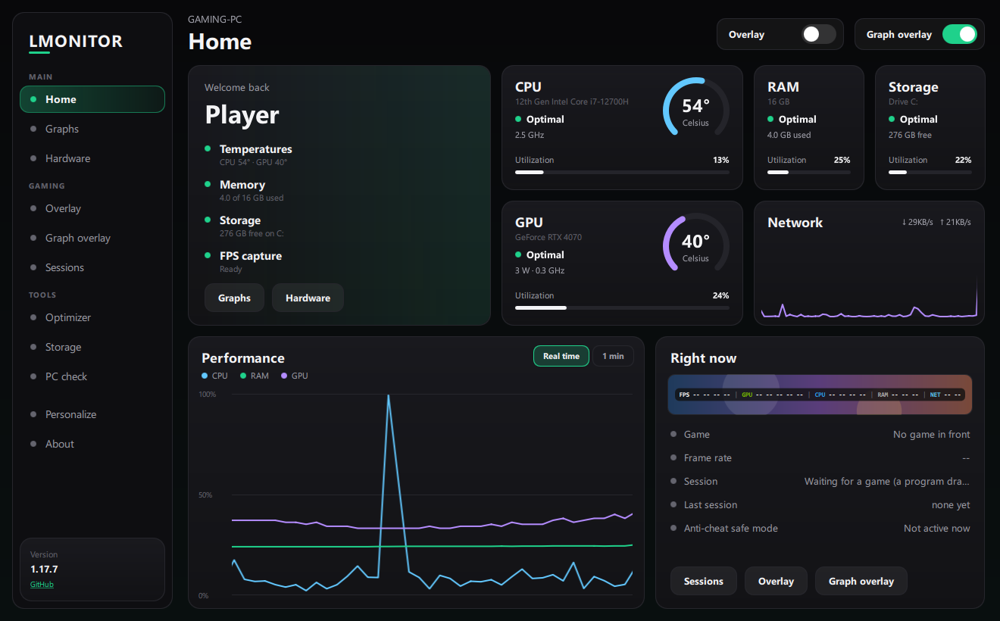
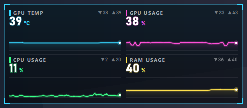
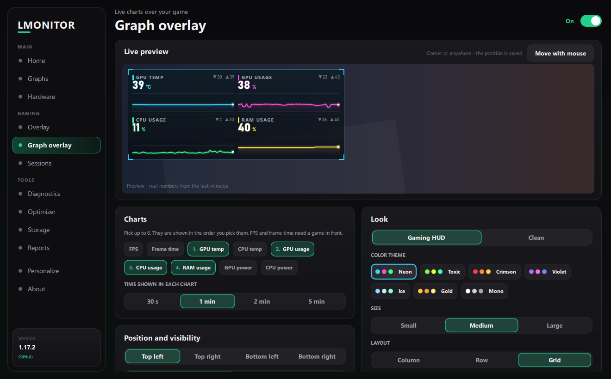
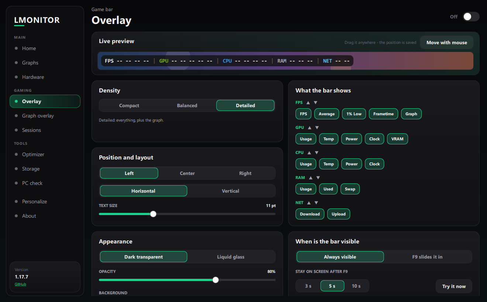
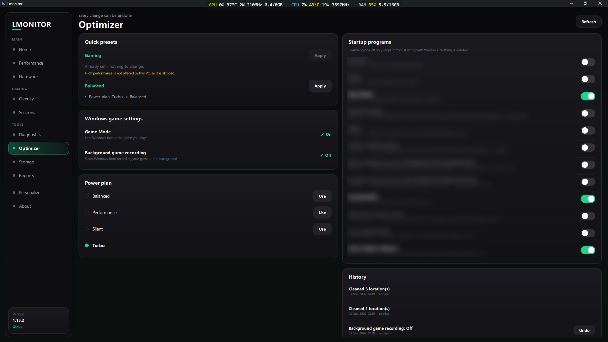

# Lmonitor

**A gaming overlay and system monitor for Windows.**
It puts a small click-through bar over your game (FPS, 1% lows, CPU / GPU / RAM load, temperatures, power, clocks, network speed), can add a **graph overlay** with live charts in a gaming HUD style, and gives you a full dashboard window with charts, game sessions, a PC check and safe cleanup tools. It is built to stay out of your game's way (see *Light on your games* below).

[فارسی](README.fa.md) · [Download](https://github.com/unrealhamed/Lmonitor/releases) · [Report a bug](https://github.com/unrealhamed/Lmonitor/issues/new?template=bug_report.md) · [Request a feature](https://github.com/unrealhamed/Lmonitor/issues/new?template=feature_request.md)

> **Status: early release (v1.17.6).** Tested by the author on one Windows 11 laptop (NVIDIA RTX 4070 Laptop GPU + Intel Core i7-12700H). Some sensors may show `n/a` on other hardware. Bug reports are welcome.

## Screenshots



| Graph overlay (gaming HUD) | Graph overlay settings |
|---|---|
|  |  |

| Overlay settings | Optimizer |
|---|---|
|  |  |

## Download and install

1. Open the [**Releases**](https://github.com/unrealhamed/Lmonitor/releases) page and download `Lmonitor_Setup_x.y.z.exe` from the newest release.
2. Run it and follow the wizard. Keep **Install the PawnIO driver** ticked: it installs the sensor driver that CPU temperature and power need on many CPUs. Desktop and Start Menu shortcuts are created.
3. Start **Lmonitor**. Windows asks for administrator rights (needed to read the sensors) - choose *Yes*.
4. Uninstall from *Settings > Apps*. The uninstaller asks whether to delete your settings (default: keep them).

> The installer is not code-signed, so Windows SmartScreen or your antivirus may show a warning. Choose *More info > Run anyway* only if you trust the download source (this repository's Releases page).

## What the overlay can show

| Group | Items |
|---|---|
| **FPS** | FPS, average, 1% low, frametime, live frametime graph |
| **GPU** | usage, temperature, power, clock, VRAM used/total |
| **CPU** | usage, temperature, power, clock |
| **RAM** | usage %, used / total, swap |
| **NET** | download and upload speed (MB/s or Mbps) |

Every item can be switched on or off. *Density* presets (Compact / Balanced / Detailed) change the whole set with one click.

Values turn from white to warning colors with load and temperature (these limits are Lmonitor's own choices, not Windows or vendor limits):

| Level | Usage (CPU / GPU / RAM / VRAM) | Temperature |
|---|---|---|
| Normal | below 30 % - white | below 40 °C - white |
| Warm | 30 % and up - yellow | 40 °C and up - yellow |
| High | 50 % and up - red | 60 °C and up - red |
| Critical | 70 % and up - dark red | 75 °C and up - dark red |

### Customize the overlay
- **Two styles:** *Dark Transparent* and *Liquid Glass* (Windows blur-behind; needs Windows 10 version 1803 or newer, otherwise a translucent dark bar is used).
- **10 backgrounds**, 6 value colors, **opacity**, **text size**, regular/bold weights.
- **Layout:** horizontal or vertical. **Position:** Left, Center, Right or custom - drag the bar with the mouse; the position is saved and kept inside the screen.
- **Order:** reorder the sections.
- **F9 mode:** instead of staying on screen, the bar can slide down from the top edge when you press **F9** (it works while a game has focus), stay for 3 / 5 / 10 seconds, then slide back. F9 is not blocked, so a game that uses F9 still sees the key.
- **Multi-monitor:** choose the display for the bar; if it is unplugged the bar falls back to the main display.
- **Click-through:** the bar never blocks your game input (except while you are moving it).

## Graph overlay

Small **live line charts** over your game - for example GPU and CPU temperature next to FPS. Turn it on in **Graph overlay** (side menu, *Gaming*). There are **two** of them (*Graph 1* and *Graph 2*), each with its own charts, place and look.

- **Charts:** FPS, frame time, GPU / CPU temperature, GPU / CPU / RAM usage, GPU / CPU power - pick up to 6, in your own order. Each chart shows the live value and the lowest / highest value of the time span.
- **Time span:** *Real time* (the last 10 seconds, read 4 times a second - frame time shows the worst frame of each moment, so stutters stand out), 30 s, 1 min, 2 min or 5 min.
- **Smooth motion:** the lines glide continuously instead of jumping once a second (or choose *Power saver*: one step per reading). Measured on the author's laptop: at most 0.3 px off a steady speed per frame.
- **Real numbers:** checked against nvidia-smi and Windows performance counters - GPU temperature within 0.3 °C, GPU usage 0.25 %, GPU power 0.04 W, CPU usage under load 1.4 %, RAM 0.14 % (average differences). The small min / max numbers are the real lowest and highest readings.
- **Look:** *Gaming HUD* (corner brackets, glowing lines) or *Clean*; 7 color themes (*Neon, Toxic, Crimson, Violet, Ice, Gold, Mono*); small / medium / large; column, row or grid; background opacity from 0 to 100 %.
- **Position:** it floats - put the mouse on its **top edge and drag it**, no button and no key (the rest of the overlay lets clicks through; while a full-screen game is in front the edge does not take the mouse, hold **Ctrl** to drag it there). You can also drag it in the page's preview, pick a corner, and choose the monitor.
- **Visibility:** always, or **F10** shows and hides it.
- **Made for gaming:** it is redrawn only when the line has moved about a third of a pixel (not at the screen's full refresh rate), never changes its size by itself, and mouse clicks go through it. Measured with a full-screen window in front: 0.2 % CPU (1 min span) / 0.7 % (real time). FPS and frame time need a game in front (PresentMon).

## Light on your games

Version 1.17.1 was a performance release. Measured on the author's laptop (RTX 4070 Laptop + Intel Iris Xe, 144 Hz screen):

- **The window is drawn on the GPU that drives the screen** (on most laptops the Intel / AMD integrated GPU), not on the game GPU. Before, Lmonitor's window used the NVIDIA GPU (about 20 % of its copy engine and ~300 MB of video memory); now it uses 0 % and ~8 MB there.
- **A full-screen game in front stops the window completely:** no chart animation and no window updates while you play. Measured with the dashboard open behind a full-screen window: CPU 1.0 % → 0.2 %, GPU 16 % → 0.7 %.
- **Background mode:** while Lmonitor is not the window you are using, it runs at *below normal* priority and asks Windows for *efficiency mode* (slower / efficiency cores), so the game keeps the fast cores.
- **The overlay bar no longer resizes or restyles itself** every time a number gets one digit longer (each resize of an always-on-top window over a game cost frames).
- **PresentMon** now only tracks frame times (no GPU-work or input tracking) and skips programs that are never games (browsers, Windows shell).

Not measured yet: the effect on FPS inside real games (please report what you see), and CPU temperature / power / clock reading costs with administrator rights.

## The window

- **Home:** CPU / GPU / RAM / Storage cards with status words, a real-time chart (1 min / 5 min / 1 hr / 24 hr), network, and a live overlay preview.
- **Graphs** and **Hardware:** live charts and detailed CPU, GPU, memory, storage, network and system information.
- **Overlay:** every overlay setting above, with a live preview.
- **Graph overlay:** the settings of the graph overlay, with a live preview that uses your real numbers.
- **Sessions:** every game is recorded automatically (a program drawing frames in front, seen by PresentMon; browsers and players are ignored; sessions under 1 minute are dropped). Each session stores average FPS, 1% / 0.1% lows from real frame times, load, temperatures and clocks. Findings only appear when the sensors prove them; a missing sensor is shown as *Unknown*, never as "fine". Data stays in `%APPDATA%\Lmonitor\sessions.db` and can be switched off.
- **PC check:** *Scan PC* looks at the PC (the scan only reads, it changes nothing) and lists what it found, worst first, each with the measured proof, a plain explanation and a shortcut to the right Windows page. It gives an explainable health score (every deduction is listed; checks Windows could not answer are never counted as healthy), compares your last two scans, and exports HTML / JSON to `Documents\Lmonitor Reports`. (This replaces the old *Diagnostics* and *Reports* pages.)
- **Optimizer:** safe, reversible changes - nothing happens without a second confirming click. Startup programs, power plans, *Gaming* and *Daily* presets (they show what they would change first), and old files in the Windows temp folders. Every change shows before / after and has an **Undo** (temp cleaning cannot be undone and says so). Lmonitor does not disable services, edit the registry in bulk, or overclock.
- **Storage:** shows what takes space. Cleanup measures known cache/temp folders and shows how much can be freed *before* deleting anything. Big folders and large files are only listed and shown in Explorer.
- **Updates:** Lmonitor looks for a new version when it starts and every 3 hours. When one is out, a bar appears on every page (*Install now* / *Later*) and a message next to the clock - no need to press *Check for updates*.
- **Personalize:** 10 app themes (dark, light, OLED black, and colored ones), 17 accent colors including your own color from a color bar, interface and text size (90 - 120 %), corner style, 6 fonts, the language (**English** or **Persian / فارسی** - in Persian the whole window is right-to-left and Lmonitor's own texts are translated; numbers stay in Latin digits), and **Start with Windows**: Lmonitor starts when you sign in and waits in the tray with the overlays ready (it uses a Windows Task Scheduler task, so there is no administrator question at each start; uninstalling removes it).
- **Tray icon:** closing the window keeps the overlay running; the tray icon opens the window, switches the overlay or exits.

Everything is saved automatically in `%APPDATA%\Lmonitor\settings.json`.

## Requirements

- Windows 10 / 11, 64-bit.
- **Administrator rights.** Lmonitor asks for them at start because the hardware sensors (especially CPU temperature) cannot be read without them.
- **CPU temperature and power** need the [PawnIO](https://pawnio.eu) driver on many CPUs (the installer offers it).
- **FPS** is captured with the bundled [PresentMon](https://github.com/GameTechDev/PresentMon).
- **Games with anti-cheat.** Lmonitor never touches a game: it injects nothing and reads no game memory; the overlays are normal Windows windows. But CPU temperature and power are read through a kernel driver (PawnIO), and kernel anti-cheat systems can object to hardware-sensor drivers. **Anti-cheat safe mode** (*Overlay* page, on *Automatic* by default) stops using that driver while a known protected game runs (Call of Duty / Warzone, Valorant, Fortnite, Apex and others): CPU temperature, power and clock then show `--`; FPS, GPU, RAM and the overlays keep working. It hides nothing - Lmonitor simply does less. No tool can promise what an anti-cheat will accept: use at your own risk.
- Lmonitor has no telemetry. It contacts the internet only to check GitHub Releases for a newer version (at start and when you press *Check for updates* in *About*) and, if you choose to update, to download the installer from there. The PawnIO download link is opened in your browser only if the bundled installer is missing.

## Run from source

You need Windows, 64-bit Python 3 and the sensor files described in [docs/BUILD.md](docs/BUILD.md) (LibreHardwareMonitor DLLs and PresentMon next to `build_qt.bat`).

```bat
git clone https://github.com/unrealhamed/Lmonitor.git
cd Lmonitor
python -m pip install -r requirements.txt

:: new Qt interface (open the command prompt as Administrator for CPU temperature)
python -m lmonitor.qt

```

`run_qt_dev.bat` starts the Qt interface without administrator rights (useful to look at the UI; CPU temperature will be missing). `run_qt_admin.bat` starts it elevated.

## Build the program and the installer

See [docs/BUILD.md](docs/BUILD.md). In short: `build_qt.bat` builds the program folder, `build_installer_qt.bat` also builds `Lmonitor_Setup_<version>.exe` (needs [Inno Setup 6.3+](https://jrsoftware.org/isdl.php)).

## Project layout

| Path | What it is |
|---|---|
| `lmonitor/engine.py` | the data engine: sensors, settings, history, sessions, diagnostics, optimizer, storage, reports (no window code) |
| `lmonitor/backend.py` | headless layer between the engine and the interfaces |
| `lmonitor/graphs.py` | short history (10 minutes) for the Graphs page and the graph overlay |
| `lmonitor/updater.py` | update check and download from GitHub Releases |
| `lmonitor/qt/` | the Qt (PySide6 + QML) interface - the main interface from v1.15 |
| `installer/` | Inno Setup script |
| `tools/` | build helper (writes the version info of the exe) |
| `tests/` | development tests (use stand-ins for drivers; run `python tests/run_all.py`) |
| `docs/` | architecture, build, release and migration notes |

## Report a bug or suggest a feature

Open an [issue](https://github.com/unrealhamed/Lmonitor/issues). For bugs please include your Windows version, GPU / CPU model, the Lmonitor version (sidebar or *About*) and, if they exist, the files `error.log` / `qt_error.log` in `%APPDATA%\Lmonitor`. For missing sensors, the *Hardware* page shows what Lmonitor could read.

## Contributing

See [CONTRIBUTING.md](CONTRIBUTING.md).

## Credits and third-party software

[LibreHardwareMonitor](https://github.com/LibreHardwareMonitor/LibreHardwareMonitor) (sensors, MPL-2.0), [PresentMon](https://github.com/GameTechDev/PresentMon) (FPS, MIT), [PawnIO](https://pawnio.eu) (driver, GPL-2.0 with an exception), PySide6 / Qt, psutil, pythonnet and nvidia-ml-py. Details and notes: [docs/THIRD_PARTY.md](docs/THIRD_PARTY.md). Please read their licenses before redistributing.

Made by a new developer named [unrealhamed](https://github.com/unrealhamed).


